# Retro UI design

The target look for the CourierQR desktop app: a 32-bit Win9x-style window, dark by default, with five colour themes. These are mockups made in the browser. The terminal UI is being rebuilt to match them in phases (see the roadmap below).

## Screens

| Screen | What it shows |
|---|---|
| 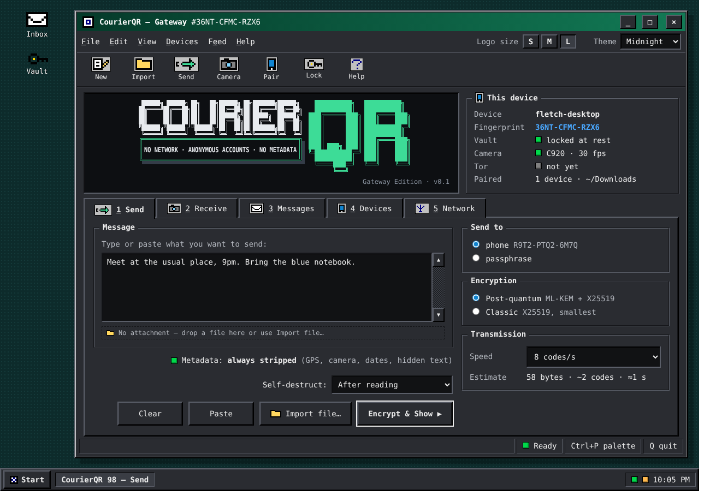 | **Send.** Message editor, Import file (the attachment row stays collapsed until a file is attached), mandatory metadata stripping, self-destruct, recipient and encryption choice. |
| 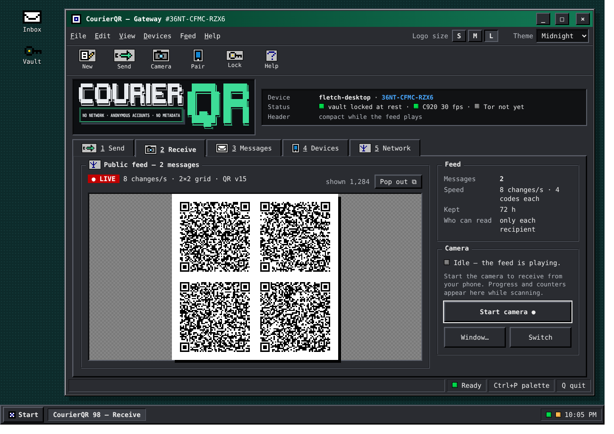 | **Receive.** The public feed playing, with a compact header so the codes get the room, and a Pop out button. |
| 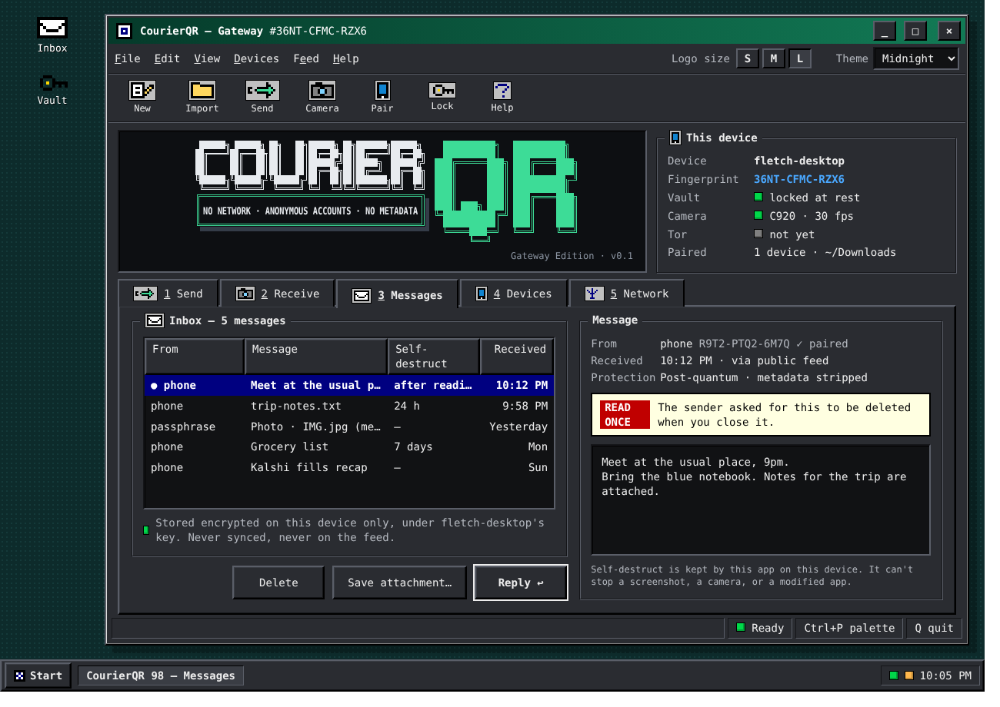 | **Messages.** Decrypted messages, kept only on this device and its key, with self-destruct timers. |
| 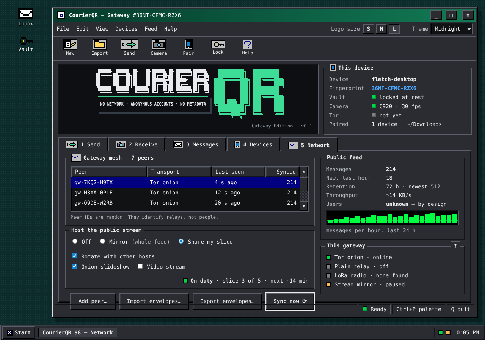 | **Network.** The gateway mesh (random peer IDs only), public feed stats, hosting (off, mirror, or share a rotating slice) and this gateway's transports, with a ? help box. |
| 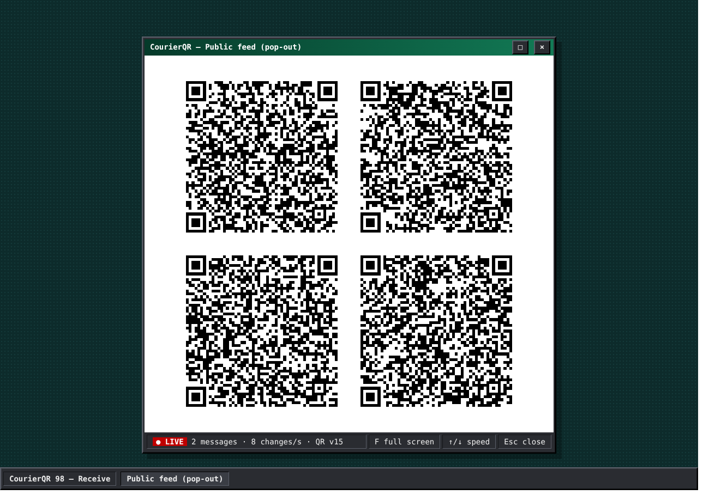 | **Feed pop-out.** The live codes in their own full-size window for scanning. |

## Unlock screen

Pidge, the pigeon mascot, changes with the local time of day.

| Morning | Midday | Dusk | Night |
|---|---|---|---|
| 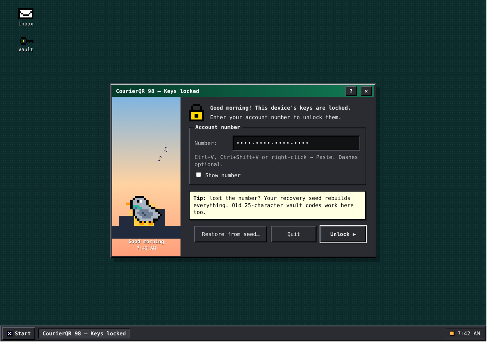 | 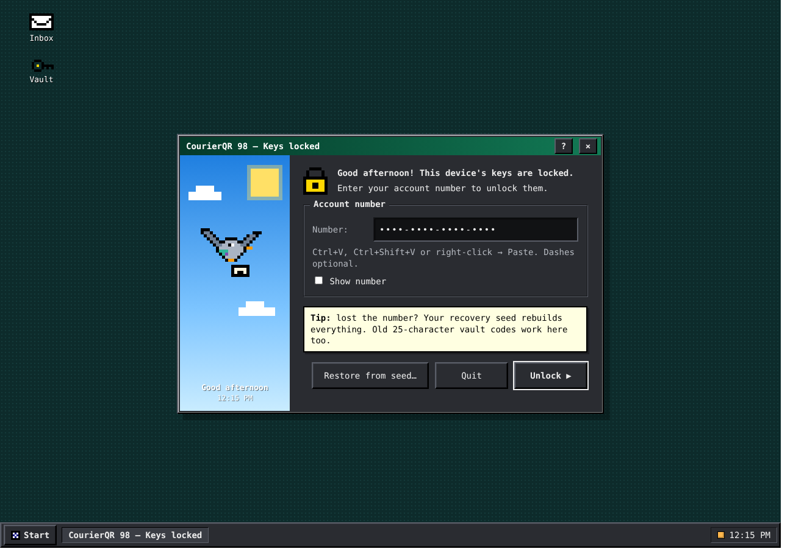 | 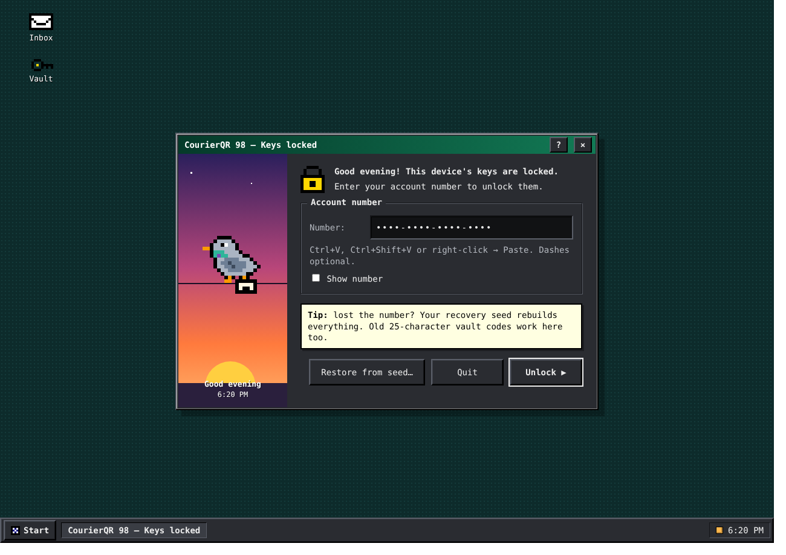 | 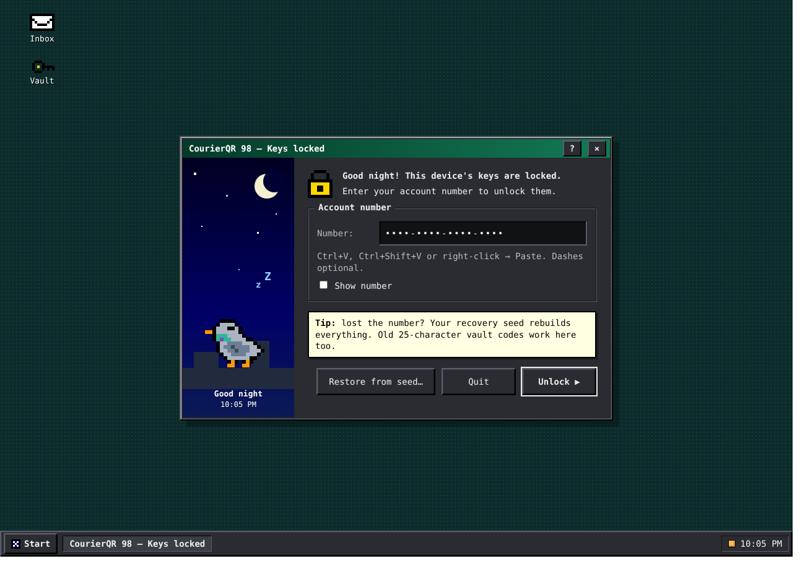 |

## Themes

| Midnight (default) | Classic | Amber | Phosphor | Synthwave |
|---|---|---|---|---|
|  | 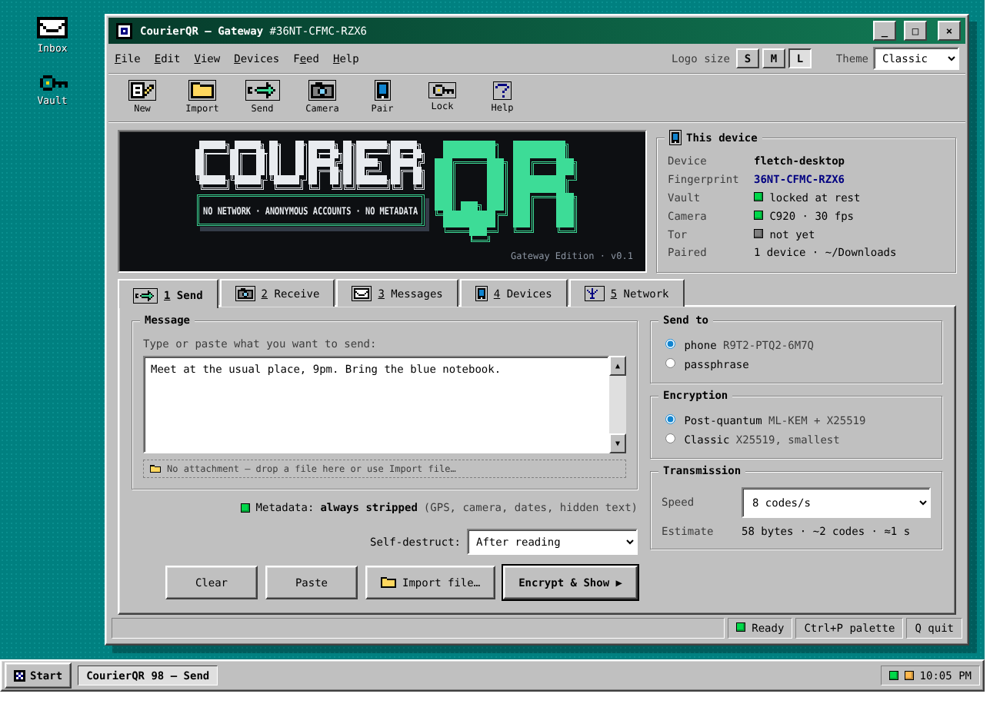 | 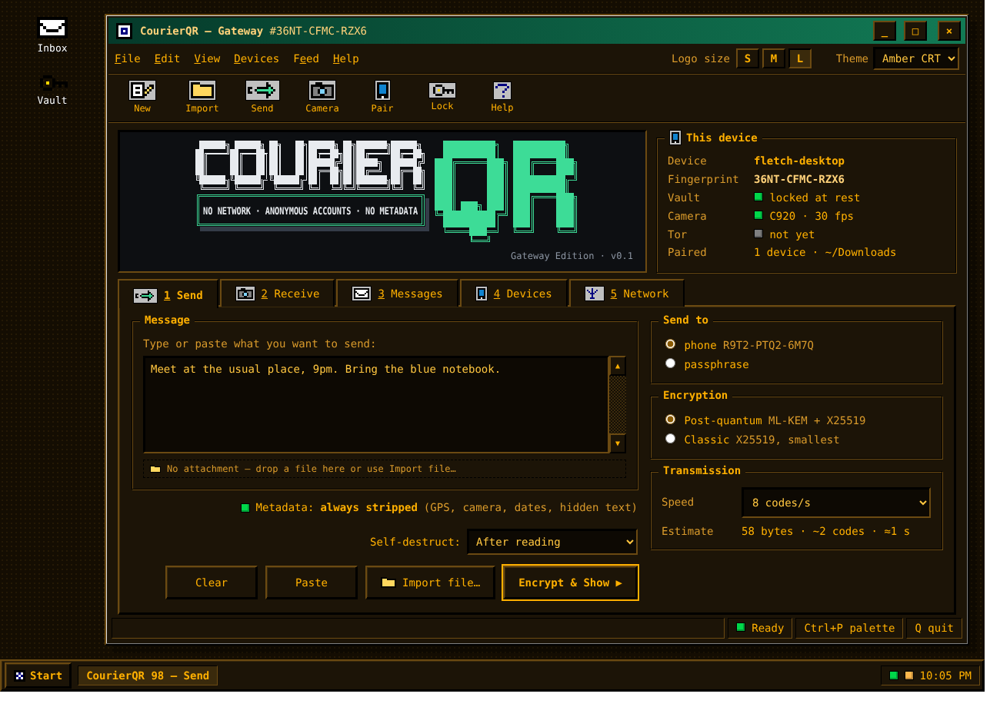 | 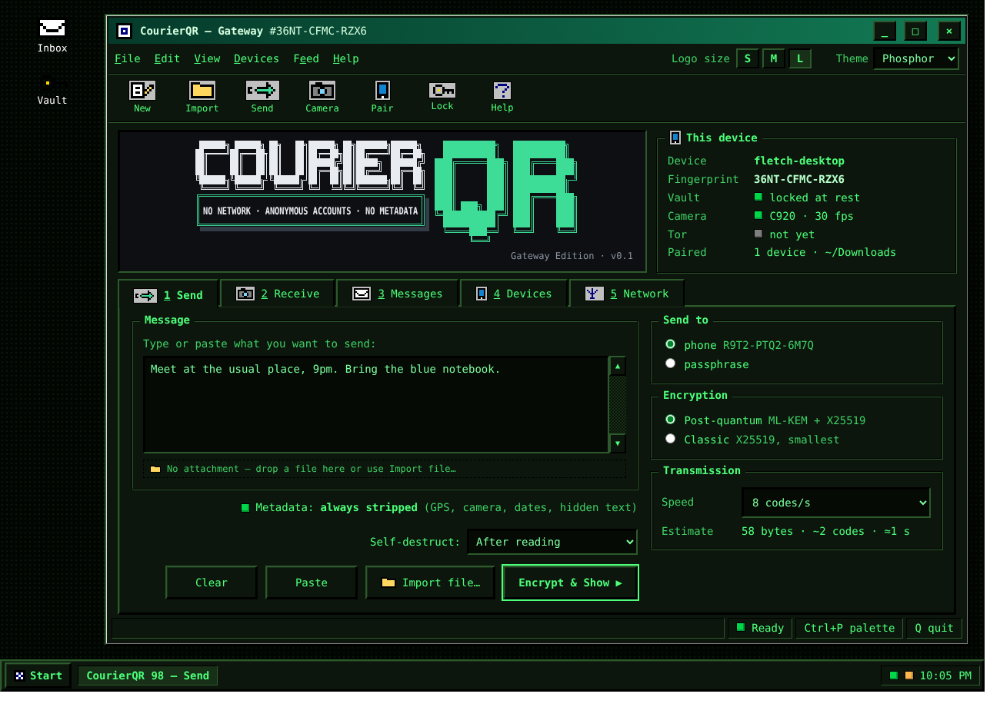 | 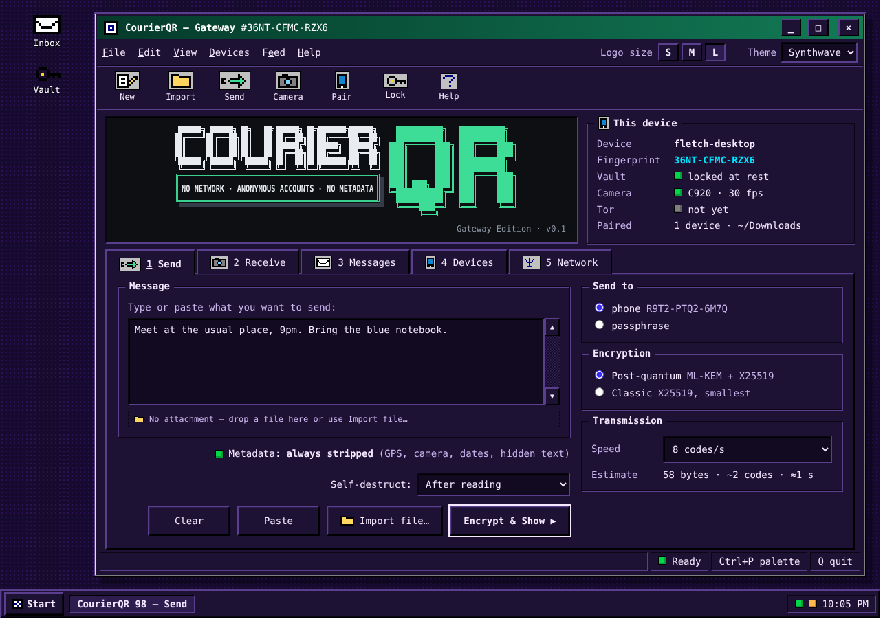 |

## Rules the design follows

- The title bar shows the device **fingerprint**, never the account number.
- Metadata is always stripped, before encryption. It's not optional.
- Saved messages live only on the device that received them.

## Terminal rebuild roadmap

1. **Done:** themes, title bar (Theme and Logo buttons), bevelled tabs, group boxes, status bar.
2. Messages tab, plus the gateway receiving messages addressed to its own key automatically (a setting, on by default).
3. Tor gateway sync with back-fill.
4. Network tab and the feed pop-out window.
5. Pidge unlock screen with time-of-day scenes.

A terminal can't match pixels exactly. Bevels are two-tone box-drawing characters, gradients come in steps, and icons are half-block art.

## Source

`source/` has the editable mockup pages (`*.dc.html`). They need the design canvas's runtime to be interactive. `render_static.py` fills in their templates so the screenshots can be made with headless Chrome:

```
python3 render_static.py Main.dc.html out.html Midnight night
google-chrome --headless=new --window-size=1300,920 --screenshot=main.png out.html
```
